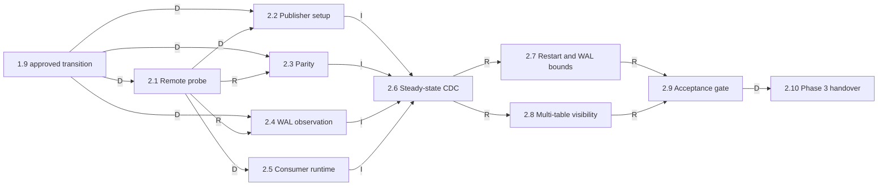

# Published Phase 2 tickets — DuckPipe CDC

**Review state.** The maintainer approved the plan in [PR #37](https://github.com/TiaanViviers/cdc-lakehouse-lab/pull/37). IDs 2.1–2.10 are published in the [Phase 2 milestone](https://github.com/TiaanViviers/cdc-lakehouse-lab/milestone/3) and recorded in the [registry](tickets.yaml). The table records the initial status on the [shared board](https://github.com/users/TiaanViviers/projects/3).

| Ticket | GitHub issue | Initial board status |
| --- | --- | --- |
| 2.1 | [#38](https://github.com/TiaanViviers/cdc-lakehouse-lab/issues/38) | Ready |
| 2.2 | [#39](https://github.com/TiaanViviers/cdc-lakehouse-lab/issues/39) | Ready |
| 2.3 | [#40](https://github.com/TiaanViviers/cdc-lakehouse-lab/issues/40) | Ready |
| 2.4 | [#41](https://github.com/TiaanViviers/cdc-lakehouse-lab/issues/41) | Ready |
| 2.5 | [#42](https://github.com/TiaanViviers/cdc-lakehouse-lab/issues/42) | Backlog |
| 2.6 | [#43](https://github.com/TiaanViviers/cdc-lakehouse-lab/issues/43) | Backlog |
| 2.7 | [#44](https://github.com/TiaanViviers/cdc-lakehouse-lab/issues/44) | Backlog |
| 2.8 | [#45](https://github.com/TiaanViviers/cdc-lakehouse-lab/issues/45) | Backlog |
| 2.9 | [#46](https://github.com/TiaanViviers/cdc-lakehouse-lab/issues/46) | Backlog |
| 2.10 | [#47](https://github.com/TiaanViviers/cdc-lakehouse-lab/issues/47) | Backlog |

The typed dependencies below also appear in the published issue bodies. Native GitHub blocked-by relationships cover 1.9 and the prerequisites that prevent a ticket from starting. The 2.1 dependencies of 2.2–2.4 and the 2.6 dependencies of 2.7–2.8 are linked in the bodies because the plan allows early preparation.

**Outcome.** Establish current-state replication from the verified stock PG16.16 publisher to a separate DuckPipe consumer with bundled DuckLake, colocated PostgreSQL catalog and persistent local data. Establish exact initial and ongoing contents, observable acknowledgements, same-slot recovery within a declared WAL budget and measured multi-table visibility limits. S3, independent DuckDB shared-lake acceptance, remote catalog deployment, transformations, reporting and write-back belong to later phases. See the [source closeout](../docs/phase-1-closeout.md), [pinned candidate investigation](../docs/experiments/EXP-010-phase-2-candidate-review.md) and [accepted ADR](../docs/decisions/ADR-002-phase-2-local-cdc-probe.md).

## Dependencies and execution waves

- **I** is a hard implementation dependency. The downstream code consumes the upstream interface or merged change.
- **R** is a runtime acceptance dependency. Prepare tests from the contract while upstream runs are pending, then rebase and validate against the accepted runtime.
- **D** is a research or approval decision gate. A negative result may close an experiment, but does not unblock implementation that needs a positive result.
- All work starts after the approved 1.9 transition. A label with multiple dependencies applies separately to each named edge. Registry dependencies list the union.

| Wave | Work | Runtime scheduling |
| --- | --- | --- |
| 1 | **Start immediately after publication** with 2.1. In parallel, 2.2 drafts publisher permission/lifecycle tests, 2.3 builds the offline oracle adapter and 2.4 builds the PG16 sampler. The probe uses small hand-checked rows and native SQL, so it needs none of these PRs. | Give the VM to 2.1 first. Source-only checks for 2.2/2.4 use fresh resources in the next available window. |
| 2 | After a supported probe decision, 2.2 finishes the publisher/credentials contract and 2.5 makes the minimal consumer setup repeatable. 2.3 and 2.4 verify their real inputs on the chosen build. 2.6 can prepare the fixture run sequence as these interfaces settle. | Reuse one controlled session to capture the accepted build's SQL output if owners agree before the run. Each acceptance result keeps its own evidence and scope. |
| 3 | 2.6 integrates the components and establishes exact S00–S04 parity. Once the stable consumer and test interfaces are known, 2.7 and 2.8 can prepare fault schedules and synthetic observation tests independently. | Run 2.7 and 2.8 sequentially on fresh disposable stacks after 2.6 passes. Neither depends on the other's experiment. |
| 4 | 2.9 repeats the combined gate from clean main. 2.10 reviews the evidence and handles the next phase transition after approval. | Reserve the VM for fresh acceptance runs. Verify previous stacks are torn down before repeating. |

## Critical path and contingencies

The risk-critical path is **2.1 → 2.5 → 2.6 → 2.7/2.8 → 2.9 → 2.10**, with a required parallel join from **2.2, 2.3 and 2.4** into 2.6. The longer of the consumer and publisher integration tracks controls that join. Runtime for 2.7 and 2.8 normally adds serial wall-clock time on this laptop even while preparation runs concurrently.

| Finding | Response |
| --- | --- |
| Missing offline dependency, startup failure or consumer crash | Capture stage, exact image IDs, version output, redacted logs and cgroup/exit evidence. Check the manifest, preload/extension files and guest budget. If evidence implicates the old artifact or minor, try a pinned rebuild on the [PG18.7 base](../docs/compatibility-matrix.md#image-provenance) with the same DuckPipe and lake commits, a recorded build toolchain/packages and a digest. If it implicates the host major, compare the [pinned PG17 image](../docs/experiments/EXP-010-phase-2-candidate-review.md#actual-observations). |
| SQL connection works but replication fails | Inspect connection class, HBA rule, auth result, publication/slot state, source version and pgoutput handshake separately. Preserve exact error, then change one factor and rerun. |
| Onboarding needs broader privileges, leaks objects or loses the snapshot boundary | Check owned table/slot inventory, role membership and grants, replica identity and lifecycle separately. Keep the same connector and test an explicitly scoped disposable bootstrap or a reviewed candidate fix. A role that requires source superuser or access outside the intended lab scope fails the proposed boundary. |
| Remote update/delete, durable restart or exact convergence fails | Preserve reproducer and last good/first bad states. A reviewed same-connector fix or alternative DuckPipe mode requires a pinned comparison and the full relevant gate. An architectural substitution requires a maintainer decision and ADR. Mark the affected gate unmet and pause dependent runtime work. |
| Catalog is 0.4, or unexpected | Record actual versions, options and file paths. Plan a format-matched Phase 3 reader and test any migration on a copy only. An older format alone does not fail local CDC. An unreadable or non-durable local sink fails the relevant Phase 2 gate. |
| No atomic Bronze cutoff or acknowledgement stalls on sparse tables | Keep exact current-state convergence mandatory. Record the observed mixed states or unobserved window, safe quiescent-read condition if demonstrated, and a residual R13 constraint for downstream coordination. A safe cutoff may require a separate test and design. Persistent WAL growth or lost committed effects blocks acceptance. |

Four independent pieces of work earn early starts because the probe is small, publisher setup has its own trust boundary, keyed parity is fixture-driven, and PostgreSQL observation has a stable PG16 schema. The reusable consumer profile follows the probe so the team can carry over the proven setup with little speculative work. Continuous CDC and first four-table snapshot share one fixture timeline. Recovery and multi-table visibility reuse that timeline but have different failure criteria and can be prepared independently. One gate and one handover keep integration ownership clear.

## Parallel development and runtime conventions

- **Source tree.** Fetch main and use a dedicated branch/worktree per ticket, such as `git worktree add -b research/2.1-remote-probe <worktree-path> origin/main`. Reserve file ownership below. Consumers import the published contracts and coordinate any breaking interface change through the issue and owning PR. Shared top-level Make/CI integration belongs to 2.9. Before final approval, integrate current main, rerun offline checks and affected disposable acceptance tests, and record the tested SHA. For dependent PRs, test prep can use fixed synthetic inputs or reviewed interface revisions. Final validation is against merged prerequisites.
- **Runtime identity.** Record owner, ticket, UTC run ID, Compose project, VM overlay, images, source/consumer volume labels, bridge ID, database, group, publication and persistent slot before mutating. Use one fresh enrolled PG16 source clone and consumer volume set per experiment, with unique `COMPOSE_PROJECT_NAME`, internal bridge, credentials and evidence directory. Never share active publisher slots or two experiment consumers on a publisher. Use explicit per-run group/publication/slot names derived from a short lowercase identifier within PG's identifier limits. Connector-generated `duckpipe_snap_<task_id>` names are isolated by fresh source clusters. Guard stop/remove operations with exact identity, expected ownership and quiescence. Retain the same project and volumes only when the experiment calls for same-state restart.
- **Network identity.** Start PG16 through the existing empty-bridge preflight on the actual bridge. Use a separate consumer service connected only to that verified internal network, with no host port bindings, extra interfaces, privileged processes or runtime pulls. Use local Docker DNS and the source's SQL database HBA with SCRAM for the scoped connector. Verify the resolved overlay and unexpectedly reachable peers before registering the group. Use source-local psql and the verified one-shot peers for publisher checks. Run target reads with consumer-local psql. Worktrees isolate files. VM, bridge, project, volumes and database ownership isolate experiments.
- **Schedule and budgets.** Use one disconnected 2-vCPU/2-GiB guest session at a time, scheduled by the maintainer or current runtime owner. Stage packages, pins and working tree from an online staging shell by read-only media before booking a guest. Start with the validated 768 MiB PG16 allowance, a **proposed 512 MiB** consumer cap and a 256 MiB one-shot runner cap (1,536 MiB total before guest overhead). Run the existing isolation probe before consumer startup and schedule other clients within the remaining budget. Limit consumer CPU initially to 0.75, PIDs to 128, swap to zero, rotate logs, and bound connections, DuckDB threads/memory and scratch growth using settings verified on the actual image. Record hard caps and measured peaks, throttling and OOMs. Use the source stop thresholds of 256 MiB allocated WAL, 512 MiB PGDATA and 1 GiB free. Predeclare consumer data/scratch limits and a run deadline. Stop on OOM, lost isolation or an exceeded bound. If the candidate cannot run under the measured budget, reduce optional concurrency/settings or request a measured guest-size revision. Do not relax egress controls.
- **Evidence identity.** Use the reserved proposed EXP IDs below. For every trial create a new ignored `artifacts/EXP-NNN/<UTC-run-id>/` directory. Keep exact command/output, tested SHA, version/image/config IDs, budgets, cleanup checks and trace metadata. Save allow-listed redacted status/SQL/log excerpts, keyed diffs, timings and resource samples. Keep the Git tree small and give reviewers an accessible manifest/checksummed evidence bundle. Avoid raw conninfo, secret-bearing SQL/error text, environment dumps and unfiltered catalog rows.
- **Merge boundaries.** 2.2 owns publisher changes, 2.3 parity, 2.4 PG16 WAL telemetry and 2.5 the consumer runtime/connector-specific observations. 2.6–2.8 own separate integration and experiment directories. 2.9 reconciles the common runbook and research status after all experiments. Each PR owns just its experiment file and records pending research updates in that report if register edits would conflict.

## Shared interfaces

| Contract | Inputs and output | Owner |
| --- | --- | --- |
| Source and runner | Existing `source-db:5432/source_lab`, `SOURCE_INPUT_ID`, v1/42, Phase 1 commands `run S00` … `run S06`, `inspect` and existing S04/S05 controls. Use the known empty source enrollment and the existing writer/reader. Verify source rows independently before comparing target. | Phase 1 baseline with 2.2 owning new files under `sql/cdc/source/` and `docs/cdc-source.md` |
| Runtime and mapping | Proposed `cdc-catalog` service plus named consumer PG and local data storage. Explicit mapping from `fixture.{customers,orders,order_items,payments}` to consumer-local names, e.g. `bronze.<same table>` if confirmed by the selected API. Store mapping, artifact config IDs and named volume identities as redacted per-run metadata. Keep query routing off and inspect target tables directly. | 2.5 via `compose.cdc.yaml`, `scripts/cdc/consumer/` and `docs/cdc-consumer.md` |
| Keyed snapshots | Each side captures at most 32 rows per relation, with overflow detection, stable PK ordering, canonical UTC timestamps and integer cents. Include all four full row sets and compute both report rows on that side. Align the captured source/target read window to explicit hold points. Write named normalized JSON snapshots and differences against `tests/fixtures/v1/expected.json`. Record a catalog snapshot ID when attribution is supported. The report is derived at read time. Source receipts, XIDs and reset metadata stay in source diagnostics. | 2.3 under `scripts/cdc/parity/` and dedicated offline tests |
| Trace | One observer samples a shared run ID, phase/checkpoint, UTC and monotonic elapsed time, sourced LSN fields, ownership and error state. Emit redacted PostgreSQL and consumer observations separately with the same labels. Null means absent or unobserved. Commit/end LSN is recorded only if exposed and attributable. Capture queue, per-table snapshot/applied LSN, persisted group checkpoint and restart identity where supported. Record first exact parity independently. | 2.4 under `scripts/cdc/wal/` for PostgreSQL and 2.5 for connector fields. 2.6–2.8 coordinate timelines. |

## Ticket definitions

### 2.1 Prove remote PG16 snapshot and DML on the pinned DuckPipe build

**Type:** research, priority:high · **Research:** R01–R04, R08, R09 · **Dependencies:** D 1.9 · **Begin:** after approval and staging of the immutable candidate. **Own:** scratch probe procedure and EXP-011. Provide a reviewer-accessible minimal reproducer for 2.5.

**Scope.** Use one synthetic keyed table on a disposable stock PG16.16 source and the pinned separate consumer with a local DuckLake path. Use an explicitly scoped lab table owner/replicator for the probe and protect Phase 1 fixture roles. Exclude reusable deployment implementation and multi-table promises.

- [ ] Capture index/amd64 manifest/config/archive identities, observed source and consumer server versions, actual preloads and extension versions, and effective HBA/SCRAM with a fresh success and a wrong-password rejection. Show separate process/network identities, no published ports and no consumer extension on PG16.
- [ ] With one persistent slot budgeted, seed one row before registration. Record exact source and direct target key/value after the initial copy, then after three separate commits: insert a second row, update the first and delete the second. Set and record a poll cadence and deadline before the run (start with 500 ms and 60 s per checkpoint). Retain last failed and first passing observations. Verify absent deleted key and no duplicate keys.
- [ ] Capture publication membership, slot plugin/activity and snapshot-slot release, connector worker state, and group/table evidence. Record actual catalog schema/format, table metadata, local root and whether data is inline or file-backed. Capture file/snapshot evidence if present. Verify source objects are cleaned up on teardown.
- [ ] Record the exact boundary of any failure, including PG logs, resource evidence and reproducible commands. A pass or reviewed verified replacement with equivalent evidence unlocks build-specific work. A negative result is a valid experiment finding and leaves M2 unmet. Keep production access and alternate sink shortcuts outside the probe.

### 2.2 Scope publisher access and verify replication-object lifecycle

**Type:** feature · **Research:** R01, R02, R04, R05 · **Dependencies:** D 1.9, D 2.1 for connector-specific provisioning and final lifecycle checks · **Begin:** prepare PG16 role/HBA/inventory controls and source-only tests immediately. **Own:** source-only provisioning, lifecycle/identity tooling and EXP-012. Consume the verified 2.1 onboarding sequence.

**Scope.** Preserve Phase 1's stock startup, schema, workload, writer, reader and reset marker. Provision only the disposable CDC source overlay. Limit temporary ownership to the four registered business tables, with publication ownership and database CREATE for registration as required. Test reducing elevated maintenance grants when steady-state apply and reconnect permit it. Keep receipt and enrollment ownership under the fixture owner and avoid broad membership in that role. Verify source fixture role privileges still work after any ownership changes. Restore ownership before any guarded reset on that clone, or create a new enrolled clone.

- [ ] Verify LOGIN/REPLICATION, scoped schema/table access, SCRAM HBA matching for `source_lab`, expected replica identities and named publication ownership. Demonstrate unrelated writes/DDL and unrelated reader connections are denied as applicable. Document PG16 replication role breadth and isolate at cluster/network level. Keep connector conninfo and secrets out of evidence.
- [ ] Enroll and remove the exact four-table publication with one persistent slot. Observe temporary slot usage with serial onboarding under the two-slot cap. Capture cleanup after a failed publication-creation path (slot created first), repeated setup and a name collision and stopped-consumer teardown. Restore prior replica identity, grants and ownership on kept disposable test volumes. Prove no owned slot/publication remains and refuse cleanup against the wrong project/database, unrelated objects or an active slot.
- [ ] Run source-only grant and fixture regression before CDC provisioning. After selecting the candidate, verify the actual connector role in an end-to-end lifecycle trial. Record catalog, role, owner, ACL, authentication and cleanup before/after queries and failure outputs in EXP-012.

### 2.3 Build independent CDC checkpoint parity

**Type:** feature · **Research:** R02, R03, R13 · **Dependencies:** D 1.9, R 2.1 for target shape confirmation · **Begin:** build the fixture adapter and comparator with offline inputs immediately. **Own:** parity module and unit tests, projection rules and EXP-013. Treat raw target SQL as an adapter over the shared snapshot contract.

**Scope.** Reuse `tests.fixture_oracle.compare_checkpoint` and the checked-in fixture. Extract bounded read-only snapshots with target mapping and per-side report computation. Keep source receipt checks in source code and gather no target readiness from the generator.

- [ ] Offline tests pass for exact S00–S06 and reject at least a missing row, duplicate key, retained deleted key, wrong value, wrong timestamp, report drift and overflow. Include a type/UTC normalization check and keep `tests/fixtures/v1/expected.json` independent of live results.
- [ ] Validate the adapter with the selected build's observed types and testable mapped-table renderings from 2.1 (one-table shape) before merge. 2.6 then owns the full four-table validation. Produce separate source and target outcomes and phase-labeled diffs. Bound extraction and poll deadlines. Capture observed catalog snapshot identity where supported and record transaction/reader semantics when a shared snapshot cannot be shown.
- [ ] Record commands, example passing and intentionally failing diffs, and the read-only/timeout behavior in EXP-013.

### 2.4 Sample PostgreSQL replication and WAL independently

**Type:** feature · **Research:** R04, R05, R16 · **Dependencies:** D 1.9, R 2.1 for samples with the selected live consumer · **Begin:** build PG16-only tooling and JSON output immediately. **Own:** publisher observations and EXP-014. Consumer metrics belong to 2.5.

**Scope.** Read-only, bounded SQL/disk observer outside the connector process. Reuse the existing local SQL and cgroup/disk checks where practical. Separate publisher positions and sampled byte deltas from durable application and latency.

- [ ] Emit explicit named slot/publication memberships and active, restart/confirmed flush LSN, WAL status and safe WAL size fields. Record `pg_stat_replication` feedback where attributable, current source insert/write/flush positions, `pg_wal_lsn_diff` spans, WAL/PGDATA size and free space. Use authorized observer privileges, bounded queries and captures, and redact credentials and unrelated sessions.
- [ ] Test empty and inactive baselines independently and active samples with 2.1's accepted runtime. Preserve nulls, reject an unexpected slot identity, and test an exhausted budget/timeout and a monotonic-clock timeline. Compare before and after values with the expected source state. Document checkpoint-dependent invalidation, lag meaning and observation blind spots.

### 2.5 Package the verified consumer and its local DuckLake sink

**Type:** feature, priority:high · **Research:** R01, R04, R05, R08, R09, R16 · **Dependencies:** D 1.9, D 2.1 · **Begin:** after a reviewed probe pass and selection of its artifact/role assumptions. **Own:** consumer overlay, staging/bootstrap, status and local catalog inspection, EXP-015. Do not duplicate publisher lifecycle SQL.

**Scope.** Translate the passing probe into a minimal repeatable profile. Use the already gated source bridge, separate consumer PostgreSQL storage for worker/catalog metadata and durable local storage for referenced data. Declare whether a named volume has distinct metadata/data paths or separate volumes are used. Defer remote catalogs and S3.

- [ ] From staged pinned artifacts in the disconnected guest, verify exact platform/config and default-deny network boundaries, health distinct from worker progress and parity, no pull, correct load/preloads and effective limits. Verify loopback trust behavior before registration and constrain it to the disposable namespace or use an explicitly verified replacement. Test a stopped worker and bad credentials without reporting readiness.
- [ ] Expose a bounded redacted status adapter and mapping, using authenticated SQL and protecting conninfo. Show catalog schema/version and snapshots, inlining option, resolved local paths and referenced physical files if used. Use the supported option to force or flush a small file-backed case if the normal fixture is inline. Verify a fresh read of the same exact contents after container recreation with preserved volumes, without source re-registration. Record actual file/catalog durability and reproducible image staging.
- [ ] Check resource limits, negative startup/health and checked teardown. Record approved HBA/configuration assumptions and evidence in EXP-015. Integration with the full four-table publisher remains 2.6.

### 2.6 Verify four-table initial copy and ongoing CDC

**Type:** research, priority:high · **Research:** R01–R04, R13, R16 · **Dependencies:** D 1.9, I 2.2–2.5 · **Begin:** prepare the test sequence once the probe passes and contracts stabilize. Integrate after dependencies merge. **Own:** `tests/integration/cdc-baseline/` and EXP-017. Use existing runner hooks, parity and telemetry modules.

**Scope.** From fresh projects, seed exact S00, hold writes during serial onboarding and advance committed S01 through S04 one checkpoint at a time. Include a bounded snapshot-window trial as a separate case. Use current-state Bronze and the selected local sink.

- [ ] Record source S00 parity before registration, exact scoped publication/slot inventory, observable snapshot/catch-up and exact independent S00 target parity across all four tables and both aggregates. Run S01/S02/S03 and require the inserted item 102, its expected full update, and its subsequent absence. Run aborted S04 and verify the S04 keys remain absent for the declared observation window. Then run committed S04 and require exact full state and reports. Keep the source receipt outside the target mapping.
- [ ] Capture each source commit/abort observation, connector progress, slot feedback, named snapshot or read boundary, first exact target result and duration under a fixed deadline. Document any acknowledgement stall or unapplied state. The workload, checkpoint evidence and file ownership must allow an independent reproduction from clean volumes.
- [ ] Test a bounded write during initial copy if a deterministic hold point is observable. Save evidence of when the copy and commit occurred and verify exact output, including no duplicated or lost effects. Mark an unhit window inconclusive with the residual risk. Keep the required quiescent initial-copy proof independent of this case.

### 2.7 Prove same-slot restart and bound publisher WAL retention

**Type:** research, priority:high · **Research:** R03–R05, R16 · **Dependencies:** D 1.9, R 2.6 · **Begin:** prepare failure schedule after 2.2–2.5 interfaces stabilize. Run against the accepted S00–S04 baseline. **Own:** `tests/integration/cdc-recovery/` and EXP-018. Consume publisher identities, parity and consumer lifecycle APIs.

**Scope.** Stop the consumer after exact S02, apply bounded S03 and S04, and restart with the same disposable group, slot and volumes. Add an abrupt consumer stop with a verifiable boundary. Use a separate clone for retention-loss testing.

- [ ] Before fault, record source/target S02 and active slot. With the consumer down, prove the same slot is inactive and the source commits exact S03 and S04 within the write budget. Observe retained WAL and last verified target state. Stop generating writes at the first limit. Restart with the same artifacts and no rebuild, slot advance/drop or reseed. Verify exact S04 including item 102's absence, continued application of a subsequent fixture step and preserved committed contents on a fresh read. Record the size/time bounds, checkpoints, logs and source/target diffs.
- [ ] Repeat with abrupt consumer termination at a controlled point around buffered/applying or acknowledged work. Document which boundary was actually reached, any replay or redelivery observed, and survival of acknowledged writes. Compare exact states and slot identities across recovery. Label untargeted crash windows inconclusive and make any durability claim specific to tested process/container interruption.
- [ ] In a separate disposable clone, attempt a checkpoint-driven retention-limit crossing under a predeclared finite write/disk/time budget. Prefer controlled segment/retention settings in that clone over a large workload. Preserve `wal_status`/`safe_wal_size`, actual disk, reconnect error or observed recovery. If WAL is lost, demonstrate a reviewed clean resnapshot against a known fixture state. Record a bounded, inconclusive outcome if the threshold cannot safely be reached. Keep the ordinary recoverable outage mandatory.

### 2.8 Characterize multi-table visibility under commit, rollback and overlap

**Type:** research · **Research:** R02, R03, R13, R16 · **Dependencies:** D 1.9, R 2.6 · **Begin:** prepare exact-state probes once the 2.3 and 2.5 interfaces are stable. Run on an independent stack after 2.6 passes. **Own:** `tests/integration/cdc-visibility/` and EXP-019. Reuse Phase 1 S04 rollback and S05 barrier evidence.

**Scope.** Observe target visibility of a single source transaction across several tables and of two ordered, overlapping source commits. Measure mixed states and convergence. Keep downstream transformation readiness outside this implementation.

- [ ] Compare exact state before, across and after committed S04, including order 30, item 301 and payment 302 and both reports. In a separate rollback case no staged S04 rows may become visible. Record each target read's snapshot/query boundaries and whether multi-relation reads actually share a catalog snapshot.
- [ ] Reuse S05 A-before-B and the after-A fault to obtain stable S04/A-only/S05 reference states. Observe exact eventual state at A-only when B aborts and S05 when both commit. Use a bounded delay or repeated observation to target mixed visibility. Prove the source barriers were reached, and avoid calling a partial result a connector issue if it came from sampling different snapshots.
- [ ] Publish the sequence, sampling cadence/deadlines, incomplete windows and earliest demonstrated safe read boundary. Report counterexamples to atomic visibility and keep R13 open wherever the experiment cannot support a general cutoff. Observing no mixed state during polling alone is insufficient for an atomicity claim.

### 2.9 Verify the complete Phase 2 CDC gate

**Type:** research, priority:high · **Research:** R01–R06, R08, R09, R13, R16 · **Dependencies:** D 1.9, R 2.7 and 2.8 (includes 2.6 baseline via both) · **Begin:** acceptance runs only after distinct evidence and dependencies are reviewed and merged. **Own:** combined entry point and runbook, shared checks and EXP-020.

- [ ] Repeat the integrated CDC gate twice on fresh projects and local volumes using the same selected artifact and current main, with one run after teardown. Require exact S00–S04 and S05/overlap evidence, aborted-change exclusion, deleted-key absence, durable same-slot recovery and an explained correspondence between feedback, consumer position and independent visibility. Include the scoped lifecycle checks and measured resource/retention/disk limits. Reuse and link the separate abrupt crash, retention-loss and multi-table experiments with their exact scope and limitations.
- [ ] Make the gate runnable by command from the disconnected guest. Run the existing offline tests and repository checks, plus the source-only `make test-integration` on a clean source project. Verify consumer replacement with preserved volumes and auth/isolation negatives. Require stable canonical checkpoint hashes, publishable keyed results and zero leaked replication objects after teardown. Capture a read-only operator walkthrough from publisher through slot and worker to actual target rows.
- [ ] Record tested source/consumer pins, catalog format, inlining/file evidence, known limitations and research statuses. Mark **M2 met** only when all mandatory positive CDC, recovery and safety outcomes hold. Keep a reproducible negative result and mark M2 unmet if a required behavior fails. Source-only correctness and status fields cannot stand in for target observation. Exclude Phase 3 storage validation.

### 2.10 Review Phase 2 findings and hand over to Phase 3

**Type:** docs · **Research:** R01–R09, R13, R16 · **Dependencies:** D 1.9, D 2.9 and closure of all other Phase 2 work · **Begin:** once the Phase 2 gate and reviews are available. **Own:** Phase 2 closeout, docs/ADR/roadmap and later approved registry and board transition.

- [ ] Review every merged Phase 2 PR and experiment against the final gate. Link exact artifacts, role/slot behavior, recovery/cutoff limits, catalog format, local data paths and reproducible correctness evidence. Record any unmet gate and get a maintainer decision before transition.
- [ ] Use the actual writer/catalog version and local data evidence to propose a Phase 3-only backlog. Reconcile documentation and research statuses and get explicit maintainer approval. Phase 3 should validate S3-backed files and independent queries on the actual catalog with a format-matched client and migration disabled on the live writer.
- [ ] After approval, reserve verified unused IDs and publish the Phase 3 milestone and approved Phase 3 issues on the existing project. Record approval, artifact links, assigned milestones, dependency links and verified statuses. Verify all other Phase 2 issues are Done before closing the milestone and completing 2.10 last. Perform no Phase 3 implementation in the handover.
