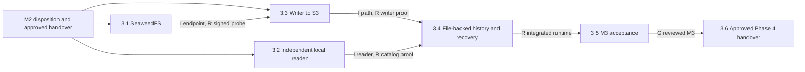

# Draft Phase 3 backlog — Shared DuckLake catalog and object storage

**Approval pending.** Candidate IDs 3.1–3.6 and corrective IDs 2.11–2.13 were unused in the registry and GitHub issue inventory on 2026-11-27. Reserve and publish after maintainer approval and another collision check. [Phase 2 disposition](../docs/phase-2-closeout.md) · [Technical strategy](../docs/phase-3-storage-strategy.md) · [Issue conventions](../docs/issue-conventions.md)

**Outcome.** Same writer catalog, real S3-backed Parquet and an independent format-matched DuckDB process that can reproduce exact current and retained fixture data after recoverable faults. Use held, verified source checkpoints. Catalog separation, live migration, shared write access, Windmill, serving and continuous-source cutoff implementation are outside this draft.

## Dependencies and start gates

**I** requires implementation or an agreed interface before dependent code. **R** requires runtime evidence before dependent acceptance, with offline work allowed against an agreed interface. **G** requires a maintainer or research decision. Every ticket requires explicit backlog/scope approval before implementation. Regular Phase 3 work starts after the authorized handover. The maintainer may separately authorize disposable early probes from 3.1–3.3 in the exact scopes below, with applicable evidence revalidated on the approved writer pin and integrated with updated main.

| Wave | Productive parallel work | Runtime and decisions |
| --- | --- | --- |
| 0 | Two independent [Phase 2 corrective workstreams](phase-2-corrections.md). Review shared interfaces and the pin manifest. | Default gate is full M2 before transition. Separately authorized early compatibility windows defer to M2 work and carry no M3 verdict. |
| 1 | **Initial Ready after publication: 3.1 and 3.2.** Two owners prepare storage and the reader independently. The 3.3 owner can sketch the probe against the reviewed interface. | Serial short storage and catalog-reader windows on fresh overlays. Prioritize available high-risk probes. |
| 2 | 3.3 proves one-table writer integration. 3.4 can prepare version/fault and parity tests offline against the interfaces. | 3.3 needs signed storage evidence. Review worker materialization before booking full trials. 3.4 runtime needs both reader and writer compatibility results. |
| 3 | 3.4 runs the full fixture storage and recovery tests. Prepare the 3.5 verification record using the same harness. | Integrate with updated main. Run 3.5 twice on fresh projects, repeating after checked teardown. Reserve one exclusive guest window and reviewer. |
| 4 | 3.6 consolidates findings and seeks approval for the next phase. | Reviewed M3 and human approval precede Phase 4 publication and Phase 3 completion. |

Expected critical path is Phase 2 correction/re-gate → 3.1 signed endpoint → 3.3 actual writer → 3.4 retained object-backed acceptance → 3.5 → 3.6. 3.2 becomes critical if the official 0.4 reader cannot attach. On an S3-specific failure use the local reader and storage probe to identify the failing layer. On a format failure, review building from the matching vendored extension or testing a compatible writer on a disposable clone. Preserve the exact layer, error and pins. An unproved actual writer/catalog path leaves M3 unmet. A new technology or gate needs a decision.

## Shared interfaces, ownership and runtime scheduling

- **Artifact contract.** Share one reviewed manifest of index/platform/config/archive or binary/extension checksums, settings and Git revision. Stage online and load offline. The reader delivers bounded normalized projections at an explicit catalog ID and snapshot. Reuse [parity/oracle](../scripts/cdc/parity/__init__.py) and [versioned reads](../tests/integration/cdc-visibility/reads.py). The storage owner provides scoped endpoint, bucket, prefix and secret file inputs. The writer owner provides catalog/table identities, stored paths, version IDs and worker state. The integration owner owns cross-component orchestration. Have the interface owner review changes to shared files.
- **Evidence contract.** Record distinct run ID, UTC/monotonic times and runtime identities. Include writer/publisher/catalog IDs, publication and slot, versions, file paths/sizes/digests and requests, exact normalized source/reader values and both reports, access failures, resources and teardown. Keep independent ignored `artifacts/<experiment>/<run_id>/` per run and agent. Commit bounded redacted excerpts and checksums.
- **Isolation.** Dedicated Git worktree and branch per agent from updated main. Integrate current main before final validation. Each runtime gets a distinct no-NIC guest overlay, Compose project, exact bridge identities and dual-stack rules, named volumes, credentials, catalog, bucket/prefix, publication and slot. Reuse the source enrollment and empty-bridge preflight. The proposed second, separately guarded lake bridge has the writer as a dual-homed endpoint. Verify it cannot forward/proxy traffic between bridges. Use network/HBA controls and verify source, reader and storage peers reach only intended services and ports, with no gateway access and no direct SeaweedFS component bypass. Publish no host ports. Preserve rules until checked teardown succeeds.
- **VM decision.** Keep the exclusive `flock -x /tmp/cdc-lab-vm-runtime.lock` for the guest lifetime. On 2026-11-27 the Ryzen 7 7730U host had 16 logical CPUs, about 15 GiB RAM, about 7.7 GiB available, 25–27 MiB free of 2 GiB swap and 59 GiB free on the worktree filesystem. Phase 2 used a 2-vCPU/2-GiB guest. The final EXP-020 pair recorded cgroup peaks of about 241 MiB publisher, 197 MiB consumer and 27 MiB runner versus hard caps of 768/512/256 MiB. Keep those caps and the existing source bounds when applicable. Stage and develop outside the guest and use short serial runtime windows. Account for guest OS/Docker overhead, stagger runner and reader, and bound object storage, multipart, log and scratch growth. Measure the combined stack under explicit caps and stop thresholds. If 2 GiB cannot cover the safe working set, propose a measured single-guest increase. Stop on lost isolation or exceeded limits.
- **Parallel runtime contingency.** A second short storage-only guest could reduce proven queue contention. Current swap and memory evidence supports staying with one slot. Before scheduling two, seek approval and compare serial versus concurrent wall time, host available memory, swap I/O/pressure, disk/overlay growth and guest peaks with foreground use. Predeclare headroom and abort thresholds. Independently verify no-NIC and firewall guarantees for each guest. Use no shared mutable media or publisher/catalog/storage identity. Keep the primary lease until an approved scheduler can enforce isolated slots, and stay serial if controls or wall-time benefit fail.

## 3.1 Qualify the local SeaweedFS S3 endpoint

**Type:** feature. **Research:** R06, R07, R15. **Depends:** G approved phase or separately authorized storage-only probe. **Begin:** after the applicable approval and agreed endpoint/identity contract. The source and writer are unnecessary for this trial.

**Objective and scope.** Provide bounded digest-pinned SeaweedFS 4.55. Validate a disposable probe bucket and protected denial bucket. Operational batch service and hosted storage are outside scope.

**Acceptance and evidence.**

- Verify offline artifact, effective caps, persistent named volume paths, authenticated readiness and isolation. Prove path-style SigV4, exact HEAD/LIST/ranged GET, small deterministic multipart completion and controlled abort.
- Prove wrong/anonymous credentials, reader PUT/Delete and cross-bucket denial and no peer access to bypass endpoints. Match object checksums across same-volume recreation. Retain request, resource, configuration and cleanup evidence.

**Ownership and contract.** Own proposed `compose.lake-storage.yaml`, `tests/integration/lake-storage/` and report. Export endpoint DNS/protocol/port, region/path-style settings and credential input/scope contract. The bootstrap principal provisions buckets.

## 3.2 Prove independent attachment to the actual 0.4 catalog

**Type:** research, priority:high. **Research:** R06, R08, R09, R13. **Depends:** R 2.5/2.6 held writer and catalog evidence, G approved phase or separately authorized held-local probe. **Begin:** after approval with actual catalog pin. SeaweedFS is unnecessary for this trial.

**Objective and scope.** Prove least-privilege attachment from a separate DuckDB process on a fresh held local writer lake. Use the inline path to isolate catalog compatibility without the writer filesystem.

**Acceptance and evidence.**

- Stage the exact CLI and extension builds. Attach to the actual DuckPipe-created PostgreSQL catalog with read-only access, no creation and migration disabled. Compare catalog identity/format before and after. Prove SCRAM success and auth, metadata writes/DDL and CDC control denial.
- Use a single explicit version for all tables. Compare exact normalized values and reports against a held source. After later CDC, reread older and newer exact versions in fresh processes. Keep the SQL, observed versions and errors or required grants.

**Ownership and contract.** Own proposed `scripts/lake/reader/`, catalog grant SQL, attachment harness and report. Supply explicit-version and identity parameters, normalized row schema, deadlines and error contract to 3.4.

## 3.3 Prove DuckPipe writes to the S3 table path

**Type:** research, priority:high. **Research:** R03, R06, R07, R08. **Depends:** I 3.1 endpoint/auth contract, R 3.1 signed storage result, G approved phase or explicitly authorized one-table early probe. **Begin:** design after approval and interface review, run after 3.1 on the recorded pin.

**Objective and scope.** Prove the actual PG writer can use the tested S3 path and credentials on a disposable one-table remote CDC project. Hold S00 for onboarding and bound subsequent DML. The live writer and alternative Bronze population are outside scope.

**Acceptance and evidence.**

- Demonstrate offline module availability, snapshot and flush worker credentials, catalog path/relative flags and exact held one-table initial COPY. Require writer-originated Parquet and actual bytes/request evidence with a fresh-worker auth failure control. Rule out unintended local file backing of the scoped rows.
- Apply source insert, update and delete over file-backed data and check exact values and physical references. Preserve physical data/delete representation, inlining/flush controls where needed, pins, path and request evidence, error stage and bounded clean teardown. Block 3.4 runtime if the required path fails.

**Ownership and contract.** Own proposed `scripts/lake/writer/`, writer storage overlay and narrow harness. Reuse CDC lifecycle, WAL observer and catalog helpers. Supply path/inlining controls, identity and object reference fields and restart procedure to 3.4.

## 3.4 Verify exact file-backed history and recovery from independent DuckDB

**Type:** research. **Research:** R03–R07, R09, R13, R15, R16. **Depends:** I 3.2 and 3.3, R 3.1–3.3, G normal Phase 3 authorization. **Begin:** offline work once interfaces stabilize, runtime after the actual writer and independent reader paths are proved.

**Objective and scope.** Combine four-table remote CDC, PostgreSQL metadata and SeaweedFS across held S00–S05 and an aborted control. Verify file-backed current and historical reads and bounded component faults. Keep the reader independent and read-only.

**Acceptance and evidence.**

- At accepted checkpoints, require actual writer-originated file backing for all four tables and named older/newer versions. Apply update and delete after initial object materialization. Link visible data/delete references and object identity to exact logical values, no duplicates, deleted-key absence and both customer reports. Capture supported rewrites or position deletes and a real scoped delete file where supported.
- Reread an older exact version after newer commits and after same-volume storage/catalog recreation in fresh readers. Independently deny catalog and object access and require the correct failure and exact recovery. Use an inline positive control and a file-backed denial. Verify matched volume, version, reference and data identity on recovery.
- Interrupt writer object access within declared publisher WAL/time limits. Show the failed stage, slot/worker and catalog/object state. Restore and require exact catch-up at the same and a subsequent held checkpoint or record a blocked recovery. Bound orphan/multipart inspection. Preserve versions, commands, requests, diffs, cgroups, scope, times and cleanup.

**Ownership and contract.** Own proposed `tests/integration/lake-history/` and report. Compose established harnesses with the unmodified oracle. Hand 3.5 the version/object/rows evidence and recovery procedure.

## 3.5 Verify the Phase 3 shared-lake acceptance gate

**Type:** research, priority:high. **Research:** R06–R09, R13, R15, R16. **Depends:** R 3.1–3.4, G reviewed writer, reader, storage pins and prior M2 disposition. **Begin:** prepare evidence once contracts are agreed. Run against updated main after the constituent runtime tests pass.

**Objective and scope.** Verify the existing M3 contract on two fresh projects under the same approved build, repeating after checked teardown. M3 is for independent reads of a shared object-backed lake under a held fixture. R08 and continuous-source R13 can remain open.

**Acceptance and evidence.**

- Both projects prove real remote writer CDC into the actual PostgreSQL DuckLake catalog, scoped referenced S3 Parquet and independent reads, exact current and retained keyed rows and both reports, updates and deletes, access controls and bounded fault recovery. Verify no live catalog format/path change, no leaked runtime or publisher objects and measured limits.
- Publish a reproducible gate procedure and walkthrough from source DML to object references to independent query, checksummed evidence and updated research statuses. Review the full M3 verdict with the maintainer. Missing, failed or inconclusive mandatory proof leaves M3 unmet and blocks regular handover.

**Ownership and contract.** Own proposed `tests/integration/lake-gate/`, runbook and experiment. Reuse the 3.4 procedure and preserve a repeatable reviewed evidence bundle for 3.6.

## 3.6 Review Phase 3 findings and hand over to Phase 4

**Type:** docs. **Research:** R06–R11, R13, R15, R16. **Depends:** R 3.1–3.5 and disposition of all other Phase 3 work, G reviewed M3 outcome and explicit maintainer approval for transition and next backlog. **Begin:** consolidate after M3 evidence is available. Seek the maintainer's decision if any gate is unmet.

**Objective and scope.** Complete this ticket last. Review writer/reader pins, metadata and object permissions, cutoff/retention behavior and measured faults. Plan only the next phase after reviewing results. Phase 4 implementation is outside the handover.

**Acceptance and evidence.**

- Link actual commands and evidence, update research and ADRs, and record the reviewed M3 outcome, snapshot contract, confirmed pins and open R08/R13 and worker-writer risks.
- Obtain explicit approval for the Phase 4 backlog and milestone, verify unused IDs, check all other Phase 3 statuses and record publication, dependency links and Ready/Backlog on the current project. Complete Phase 3 and this ticket last after approval.

**Ownership and contract.** Own closeout, roadmap, research, architecture and ADRs, then later approved registry and board updates. Carry exact reader, held cutoff, retention and lineage evidence into next-phase planning.
