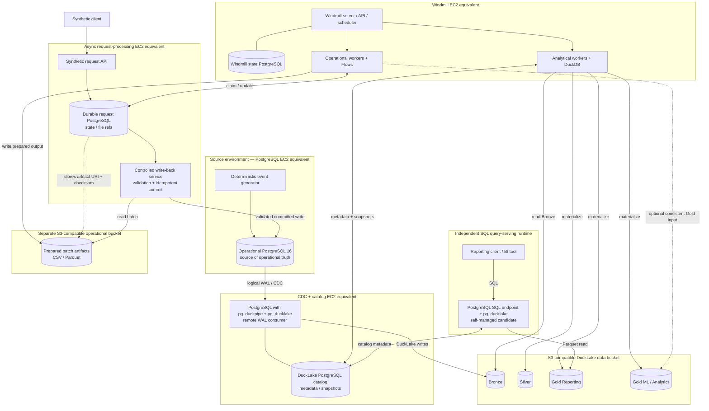

# Reference architecture — full approved PoC target, unverified integrations

**Status:** Full logical topology accepted for research on 2026-11-24. Technologies and interfaces must still be validated. See [editable draw.io diagram](Data_System.drawio), retained at its existing path.

## Logical data flows

*Conceptual arrows indicate relationships, not confirmed API mechanics. In particular, the Windmill workers and query service require both **catalog access** and **object-store access**. Internal Bronze → Silver → Gold is a transformation dependency, not compute running inside S3. Windmill may also schedule the write-back service; that interaction is omitted to avoid clutter.*

## Deployment / responsibility matrix

| Logical environment | Likely AWS host candidate | Process and responsibility | Persistent state |
| --- | --- | --- | --- |
| Source operational | Existing EC2 or RDS | PostgreSQL with application transactions and logical WAL | Source tables and WAL |
| CDC / catalog | Dedicated EC2 or compatible self-managed PG | pg_duckpipe and pg_ducklake extensions; CDC worker process | CDC state and catalog metadata PostgreSQL |
| Lake data | S3 bucket | Object storage API, **no SQL compute** | DuckLake-managed Parquet objects |
| Windmill | EC2/ECS; can split workers later | UI/API, scheduler, job queue + DuckDB/Python workers | Separate Windmill PostgreSQL |
| SQL serving | Dedicated EC2 *logical service*, optional separate host | PostgreSQL-compatible SQL endpoint with pg_ducklake candidate | Service configuration/cache, not a second copy of all Gold |
| Async request processing | Dedicated EC2 *logical service* | Request API, durable request database, controlled write-back; Windmill ops workers may run on Windmill host | Separate request PostgreSQL |
| Operational batch storage | Separate S3 bucket/prefix + IAM boundary | Prepared outputs outside DuckLake catalog | Files and checksums, not DuckLake tables |

**Important distinction:** these are separate trust/failure/compute roles. A full PoC can isolate them in Docker Compose on one computer; "five EC2 boxes" is not a requirement for five real VMs. Query service isolation is an acceptance goal even if initially co-located for bootstrap testing.

## DuckPipe and catalog

DuckPipe's extension-based implementation needs a compatible PostgreSQL host but can ingest from a **remote** PostgreSQL source, so it does not belong on production. For initial tests, colocate DuckPipe, pg_ducklake and catalog metadata on one host. A separate catalog PostgreSQL/RDS design requires proof. Do not install unsupported custom extensions inside a managed RDS instance merely because RDS can store DuckLake metadata.

A DuckLake catalog maps tables/snapshots to Parquet files. DuckDB computation happens in external processes (e.g. Windmill workers), not inside the S3 bucket.

## Pipeline contract

DuckPipe continuously follows changes. Windmill runs scheduled and/or event-triggered SQL transformations, initially using explicit Flows, then comparing asset-based Windmill Pipelines. External DuckPipe writes may not trigger Windmill assets automatically. Transformations should use defensible readiness and stable snapshot cutoffs; "streaming" or empty queue is insufficient proof of cross-table consistency.

Bronze is a replicated **current-state** copy unless change-history semantics are separately established. Silver is cleaned/integrated data; multiple Gold schemas serve reporting, analytics and ML.

## SQL reporting contract

Reporting clients send SQL to the query-serving process, **not directly to the metadata catalog**. That process consults catalog PostgreSQL for metadata/snapshot state and reads the corresponding Gold files from S3 through its query engine. Candidate: self-managed PostgreSQL with pg_ducklake (including remote-catalog FDW where compatible). Run direct DuckDB reads as a correctness baseline. SQL protocol, permissions, performance, concurrency, lifecycle and separate-host interoperability are research questions, **not verified design guarantees**. See [query-serving contract](query-serving.md).

## Operational processing contract

The request PostgreSQL stores accepted jobs, idempotency keys, status/progress and immutable output object URIs/checksums. An API persists requests first; Windmill operational workers generate candidate results, optionally reading a specified Gold snapshot. Store large batches in **separate operational S3 storage**; a controlled write-back validates, applies and acknowledges each batch to operational PostgreSQL.

The source transaction must record a durable unique request/batch receipt atomically with its business writes so crash-after-commit retries are safe. Request store state may lag; reconcile from operational receipts. If source is unavailable, jobs may reach PENDING_COMMIT, but are **not operationally valid** until source commits. Do not use DuckPipe in reverse. After successful commit, ordinary source CDC reflects results into the lake. See [async-processing contract](async-processing.md).

## Phase 0 evidence and first implementation slice

The [Phase 0 closeout](phase-0-closeout.md) records reviewed designs, version candidates and repository checks. The first implementation slice is the isolated PostgreSQL source simulator, with its own source volume, synthetic workload and direct SQL inspection. [Proposed ADR-001](decisions/ADR-001-phase-1-source-baseline.md) specifies a bounded logical-WAL configuration baseline for Phase 1. The remote consumer, publication and slots enter in Phase 2. Proof of the listed downstream integrations remains open.

## Integration risks to test

1. Remote WAL replication, slot retention, snapshot / delete correctness.
2. Catalog ownership and DuckPipe / external DuckDB / Windmill multi-writer interoperability.
3. Object-store consistency, versions, snapshot retention, permissions and S3 cost characteristics.
4. Cross-table readiness and failure-safe downstream publication.
5. PostgreSQL protocol compatibility, FDW remote catalog behaviour, query isolation and concurrent clients.
6. Durable request admission, result persistence, outbox/poll recovery, exactly-once **effects** with retries.
7. Avoiding operational dependency on lake freshness or catalog availability for simple requests.
8. No replication loop on write-back; no accidental treatment of provisional data as issued vouchers.

## Documentation / sources

- [DuckPipe repository](https://github.com/relytcloud/pg_duckpipe)
- [pg_ducklake repository](https://github.com/relytcloud/pg_ducklake)
- [pg_ducklake foreign data wrapper](https://github.com/relytcloud/pg_ducklake/blob/main/pg_ducklake/docs/foreign_data_wrapper.md)
- [DuckLake specification/docs](https://ducklake.select/docs/stable/)
- [Windmill Pipelines](https://www.windmill.dev/docs/core_concepts/pipelines)
- [RDS allowed extensions](https://docs.aws.amazon.com/AmazonRDS/latest/UserGuide/PostgreSQL.Concepts.General.FeatureSupport.Extensions.html)
