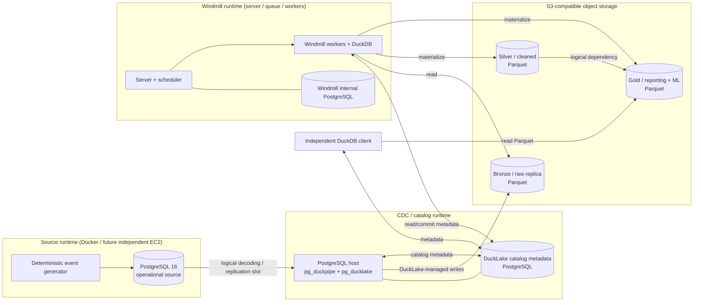

# Reference architecture (hypothesis)

## Logical topology

*Arrows are logical interactions, not verified wire-level protocol traces. The Silver/Gold data read/write also requires object storage and catalog access; some edges are omitted for readability.*

## Physical runtime separation

| Runtime | Runs compute? | Persists what? |
| --- | --- | --- |
| PostgreSQL source | Operational SQL, WAL | Transactional source records, WAL |
| DuckPipe-compatible PG host | CDC workers, extension code | CDC state and possibly DuckLake catalog |
| DuckLake catalog PostgreSQL | Catalog SQL transactions | Table metadata, file/snapshot mapping, not analytical rows |
| S3-compatible service | Object storage API | Parquet objects and related files |
| Windmill | Orchestration server + worker processes | Internal PostgreSQL queue/state; DuckDB jobs use worker CPU/RAM |
| External DuckDB | SQL engine in client process | Query results / temporary cache |

The CDC host and catalog may initially be colocated for the PoC. A remote independent catalog (e.g. RDS later) is an **experiment**, not an assumed configuration. Windmill's internal PostgreSQL is an unrelated DB. A reporting SQL endpoint is **not in initial scope**.

## Conceptual datasets

- **Bronze**: CDC-maintained source-aligned current-state tables; not automatically an immutable event log.
- **Silver**: one or many tested DuckDB SQL transformations (clean/validate/join) materialized as lake assets.
- **Gold**: separately named reporting, analytics and ML-facing tables; may depend on multiple Silver assets.

Whether DuckPipe can place raw tables in a specified Bronze schema, and whether Windmill's asset identifier syntax supports exact multi-schema destinations, must be verified with installed versions.

## Orchestration boundary

DuckPipe is primarily continuous CDC, not an hourly copy script. Initial Windmill experiment: manually run one SQL transformation after verifying Bronze. Later experiment: a scheduled coordinator checks a defensible ingestion cutoff and triggers Windmill processing. A streaming state or zero queue depth alone does **not** establish cross-table transaction consistency.

## Critical integration unknowns

1. DuckPipe version and remote PG16 logical-replication compatibility.
2. S3-compatible endpoint, credentials and object layout with DuckPipe/pg_ducklake.
3. Exact catalog ownership/compatibility between pg_ducklake and DuckDB DuckLake extension.
4. Windmill managed Pipelines using the same catalog and avoiding cross-writer conflict.
5. Stable multi-table snapshot/cutoff semantics, CDC deletes and retries.
6. Query service maturity, throughput and reporting concurrency (deferred).

## Deployment mapping, not commitment

Separate logical runtimes can all run on one local Docker host. In AWS, EC2/ECS can host services/workers and RDS may act as a DuckLake metadata catalog. Standard RDS cannot be assumed to load unapproved custom PostgreSQL extensions. Query serving is another separable concern.

## Technical references

- https://www.postgresql.org/docs/16/logical-replication.html
- https://www.postgresql.org/docs/16/warm-standby.html#STREAMING-REPLICATION-SLOTS
- https://github.com/relytcloud/pg_duckpipe
- https://github.com/relytcloud/pg_ducklake
- https://ducklake.select/docs/stable/
- https://www.windmill.dev/docs/
