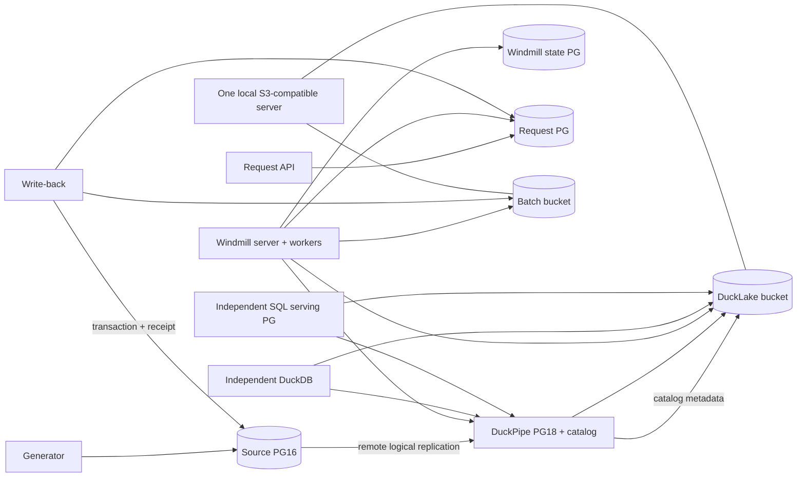

# Local runtime design — ticket 0.2

**Status: design proposal, 2026-11-24.** No Compose configuration or integration has been run for this ticket. This translates the [architecture](architecture.md) into a disposable single-host lab, not five VMs. It covers service roles, isolation, resource ceilings and staged startup; implementation, production access and claims of interoperability are outside scope. Candidate versions and immutable image identities are in the [0.1 compatibility matrix](compatibility-matrix.md); they are research inputs, not a compatible stack certified by this design.

## Topology and compatibility gates

Arrows describe required relationships, not tested interfaces. The catalog stores metadata and snapshots; the S3 service stores objects; DuckDB/extension processes execute queries. Reporting must read both catalog and Gold Parquet. Request state, Windmill state, source, catalog and query-serving databases have distinct roles. Query-serving PostgreSQL is an independent process with its own database/configuration; it is not the catalog SQL endpoint. Initial CDC and catalog metadata may share the consumer PostgreSQL instance. All roles may share the physical laptop, never the source PostgreSQL process or its data directory with DuckPipe. Workers may share one Windmill runtime and initially execute analytical and operational jobs serially, with separate identities and permissions. Separate logical services remain separately deployable and independently testable even when co-located.

The first CDC test uses the 0.1 PG16 publisher and isolated, digest-pinned PG18 DuckPipe CI image. Its bundled dependency expects catalog format 0.4; the standalone pg_ducklake serving candidate expects 1.0 and Windmill's candidate native runner is newer. **Do not attach or migrate the live catalog with a newer client until actual format and shared compatibility are proved.** First test DuckDB 1.5.1 against the confirmed format with migration disabled; experiment on a disposable copy for migration. PG18 hosting the consumer does not establish remote PG16 compatibility. The CI image has loopback trust rules: keep it confined to the disposable CDC experiment, leave its port unpublished, exclude untrusted processes from its network namespace, inspect `pg_hba_file_rules` and verify fresh connections before registration. The image is not a general secure deployment. See [EXP-001](experiments/EXP-001-component-compatibility.md).

## Proposed services

All host ports below are **optional**, bound to `127.0.0.1` only when needed, and unpublished by default; service-to-service traffic uses container ports and local service DNS. Names and signals are design targets, not executable configuration. Each persistent volume is separately named and project-scoped; bootstrap jobs must be idempotent and exit successfully before dependents use their output.

| Service | Role and startup dependencies | Persistent storage | Optional host port → container port | Health/readiness signal |
| --- | --- | --- | --- | --- |
| `source-db` | Stock PG16; starts first; generator, CDC and write-back connect with different roles | `source-pg` (tables and WAL) | 15432 → 5432 | `pg_isready` plus authenticated database query; check logical settings and slot separately |
| `generator` | Bounded deterministic synthetic workload; waits for source DB and schema bootstrap | None; fixture definitions in repository | None | One-shot completion and expected source values; not a daemon |
| `cdc-catalog` | DuckPipe host and initial metadata catalog; waits for source and source bootstrap; storage only when S3 phase is enabled | `cdc-pg` (extension state, catalog and local test data) | None for CI image | PostgreSQL readiness, extensions loaded and separate DuckPipe status/slot inspection; readiness is not replication correctness |
| `object-store` | SeaweedFS 4.55 candidate; serves both buckets; starts before bucket bootstrap | `object-data` (server metadata and objects) | 18333 → S3 API port, only for inspection | Version-specific service readiness plus authenticated S3 operation; exact container ports/configuration to verify |
| `bucket-init` | One-shot provisioner; waits for object store; creates `lab-ducklake` and `lab-batches` and scoped principals/policies | State in object store; no local volume | None | Idempotent completion and positive/negative bucket access checks |
| `duckdb-client` | Independent, read-only correctness client; waits for compatible catalog and bucket | None; bounded scratch only | None | One-shot query of known values after catalog attach and Parquet flush |
| `windmill-db` | Dedicated Windmill internal state PG18 candidate | `windmill-pg` | None | `pg_isready` and authenticated query |
| `windmill-server` | API/scheduler; waits for state DB and its migrations | State in `windmill-pg` | 18000 → verified server port | Version-specific HTTP readiness and completed migrations |
| `windmill-worker` | One worker initially; waits for server/state; analytic jobs need compatible catalog and lake; operational jobs need request DB and batch bucket | Bounded ephemeral job scratch/cache; no shared DB volume | None | Registered worker and bounded test job; job success does not prove data correctness |
| `query-service` | Independent PG18 + pg_ducklake candidate; starts after compatible catalog and lake; reporting clients use this endpoint | `query-pg` (service DB/configuration; not lake data) | 15435 → 5432 | PostgreSQL readiness plus authenticated known Gold query reading catalog **and flushed Parquet** |
| `request-db` | Independent request-state PG16 | `request-pg` | 15434 → 5432 | `pg_isready` and authenticated query |
| `request-api` | Accepts requests durably; waits for request DB/schema, not source availability | State in `request-pg` | 18080 → verified API port | HTTP readiness plus request DB connectivity |
| `write-back` | Controlled batch validation and source transaction/receipt; waits for request DB, batch storage and source when committing | No private durable state; receipts in source, status in request DB | None | Process readiness and dependency checks; unavailable source leaves requests pending |
| `inspect` | Optional trusted SQL/S3 inspection client; only joins the network needed for a bounded session | None | None | Explicit authenticated read; terminate after inspection |

The S3 API container port, UI ports, Windmill endpoint and image-specific health commands must be verified at implementation. Host port proposals are collision-checked locally before use. No browser console or database port is exposed on all interfaces. Loopback publishing itself has Docker-version and host-routing caveats; verify the deployed Engine and host firewall and test from another host. Never rely on a port binding as the only security control.

## Network and identity boundaries

**Decision:** all workload networks are Docker `internal` networks, with no default external network, host networking, privileged containers, Docker socket, production DNS names, production credentials, or production network mounts. Pull pinned images and stage required extensions separately before bringing up isolated workloads; no runtime auto-download. Deny egress at the host/VM firewall as a second control, including IPv6, DNS and routes to LAN/VPN; verify this from every workload network. An `internal` network alone is not a complete host firewall or protection against a privileged host, a multi-homed process acting as a proxy, or direct host access. If the host cannot enforce and demonstrate the deny policy, do not start the lab. Loopback-only UI access is for the trusted local operator; disable broad published ports and do not attach untrusted containers. No claim of production-grade isolation is made.

Use separate internal networks to limit reachability; Docker network membership is bidirectional and does not enforce application-level direction. A service only joins the networks listed below, with database grants and object policies restricting operations. Avoid shared default networks; an administrative bootstrap identity is temporary and absent from regular jobs.

| Network | Members and allowed application intent |
| --- | --- |
| `source-cdc` | `source-db`, `cdc-catalog`: source replication identity SELECT/replication only, plus narrowly scoped publication setup privileges proven for the actual connector |
| `source-input` | `source-db`, `generator`: fixture-only writes |
| `source-commit` | `source-db`, `write-back`: narrowly scoped business writes and atomic unique receipt |
| `catalog` | `cdc-catalog`, `duckdb-client`, `windmill-worker`, `query-service`: individually authenticated catalog roles; read-only where supported; analytical writer only after multi-writer validation |
| `lake-objects` | `object-store`, `bucket-init`, `cdc-catalog`, `duckdb-client`, `windmill-worker`, `query-service`: S3 lake credentials, no batch access |
| `batch-objects` | `object-store`, `bucket-init`, `windmill-worker`, `write-back`: S3 batch credentials, no lake access except a separately scoped optional analytical reader |
| `windmill-state` | `windmill-db`, `windmill-server`, `windmill-worker`: only required Windmill identities and job protocol |
| `requests` | `request-db`, `request-api`, `windmill-worker`, `write-back`: distinct admission, worker and commit roles |

The same server and worker join multiple networks; membership is not transitive routing, but compromised multi-homed applications can bridge boundaries. S3 bucket authorization is therefore essential even when networks differ. The independent client and inspection tools join only necessary networks for the session. The request API never needs source or lake access; write-back cannot write Bronze. Reporting clients connect only to the query service; its read-only FDW setting, PostgreSQL grants and Gold-only S3/catalog access must be tested, since FDW is updatable by default. If catalog permissions cannot enforce Gold-only access, do not expose it to less-trusted clients; record the limitation and resolve it before that boundary is claimed.

Use disposable, distinct generated credentials per role, provided via local untracked secret files or the runtime's secret mechanism; commit placeholders only. Avoid secrets in CLI arguments, logs and evidence. DuckPipe's connection string is stored in its sync-group metadata: restrict catalog access and redact dumps. Configure source authentication explicitly; no blanket trust beyond the isolated image caveat above. Synthetic deterministic fixtures only; source WAL retention and slot counts must be bounded, monitored and failure-tested. A lost/invalid slot requires documented recovery, not silent unlimited retention.

### Bucket and credential contract

One server hosts two distinct buckets: `lab-ducklake` for DuckLake-managed Parquet and `lab-batches` for ordinary prepared request artifacts. Separate identities/policies are required even though a server administrator can access both. Proposed minimum grants:

| Principal | DuckLake bucket | Batch bucket |
| --- | --- | --- |
| CDC writer | Required lake reads/writes | Deny |
| Analytical worker | Lake reads and scoped Silver/Gold writes after validation | Deny by default |
| Independent client / reporting | Read required objects only; no writes | Deny |
| Operational worker | Deny by default; separate optional Gold read identity | Create/read required artifacts; no unrelated deletion |
| Write-back | Deny | Read approved artifact/version only |
| Bootstrap administrator | Provision policies and buckets only; removed from normal workloads | Same |

Verify both positive and cross-bucket denied operations with each actual client; S3 policy semantics and prefix-level Gold isolation are unproven. Test signed path-style access, range reads, listing, multipart, and persistence. Phase 6 must prove conditional creation or versioned retrieval and checksums; an object reference alone does not make an artifact immutable. No provisional batches go into Bronze. Source receipt and business effects must commit in the same transaction; request status can lag and must reconcile from source.

## Laptop budget and startup sequence

These are **proposed hard memory ceilings**, not measured usage or guarantees. With a 16 GiB host reserve at least 6 GiB for OS, Docker, browser and caches; target at most 10 GiB aggregate container limits, including optional tools. CPU quotas are ceilings, not dedicated cores. Use a single worker and one concurrent job, small bounded fixtures, bounded DuckDB threads/memory and scratch disk, bounded PostgreSQL connections and slot/WAL retention. Verify actual cgroup enforcement, swap behavior, disk space and OOM events; reduce or stop optional services before increasing limits. Limit log rotation and set a disposable data/disk budget in implementation; memory ceilings do not bound persistent volumes.

| Group / service | Memory ceiling | CPU ceiling (cores) |
| --- | ---: | ---: |
| Source DB + generator | 768 MiB + 256 MiB | 1 + 0.5 |
| CDC/catalog | 1536 MiB | 2 |
| Object store + bootstrap | 768 MiB + 128 MiB | 1 + 0.25 |
| Independent DuckDB client (on demand) | 768 MiB | 1 |
| Windmill DB + server + one worker | 512 + 768 + 1536 MiB | 0.5 + 1 + 2 |
| Query service | 1024 MiB | 1 |
| Request DB + API + write-back | 512 + 256 + 384 MiB | 0.5 + 0.5 + 0.5 |
| Optional inspection | 256 MiB | 0.5 |
| **Total if all enabled** | **9472 MiB (9.25 GiB)** | **12.25** |

CPU ceilings can oversubscribe a laptop; serialize workloads and measure contention. The total includes transient generator, bucket-init, client and inspection concurrently for a conservative ceiling. An engine or worker may need more than its proposed cap; treat OOM as evidence and adjust the profile or hardware rather than assuming the full demonstration fits. Include the DuckDB per-process memory cap below the worker container limit so the worker and subprocess overhead have headroom.

1. **Phase 1 `source`:** source DB, schema bootstrap, then bounded generator. Verify exact deterministic rows, mutations, bounded WAL settings, and zero publications and slots. Verify host egress controls before starting the workload. See [proposed ADR-001](decisions/ADR-001-phase-1-source-baseline.md).
2. **Phase 2 `cdc`:** add consumer; register one small source table after source readiness and security inspection. Compare values across insert/update/delete; inspect source slot and DuckPipe status. Use isolated local sink initially.
3. **Phase 3 `storage`:** add object store and bucket bootstrap, then compatible independent DuckDB client. Verify catalog format, flushed Parquet and actual object reads, including denial tests; a query served solely by inlined rows is insufficient.
4. **Phase 4 `windmill`:** add separate state DB, server and one worker only after compatibility gate. Run an explicit Flow and check Bronze/Silver/Gold contents and snapshot, not only job status. Pipeline support remains research.
5. **Phase 5 `reporting`:** add independent serving process and synthetic client. Compare exact Gold results against independent DuckDB; separately interrupt catalog and object access.
6. **Phase 6 `requests` / `batches`:** add request DB/API and write-back; reuse the same object server and the separate batch bucket. Demonstrate pending operation with source down, then atomic receipt and idempotent retry after commit. No reverse CDC.
7. **Phases 7–8:** add optional inspection only as budget allows; collect resource, correctness and failure evidence, then exercise documented recovery. Do not treat health checks or container startup as phase gates by themselves.

Profiles are proposed groups, not existing commands. Implementation must resolve profile dependency activation explicitly, gate bootstrap completion and handle lost dependencies/retries after startup; Compose startup ordering does not provide ongoing availability. Stop transient clients/jobs when finished; do not delete persistent volumes except by an explicitly documented disposable-local reset.

## Questions for implementation tickets

- What exact image/extension builds, resource limits and authentication rules actually start on the target architecture, and can source PG16 replicate to the pinned consumer with least-privilege publication setup? How does a bounded slot recover after exceeding retention?
- What catalog format does the running image create? Can matched DuckDB, Windmill and a separately built serving process read/write it without migration or conflicting snapshots? Which migration/copy and rollback procedure is safe?
- Which SeaweedFS ports, health probe, persistence layout, bucket policy and principal configuration work with all pinned clients? Are range, multipart, denial and immutable/versioned batch reads correct after restart?
- What are Windmill's actual server readiness, worker registration, job memory behavior, network requirements and Flow readiness semantics? Can its runner use the matched extensions without network downloads?
- Can catalog and object permissions enforce Gold-only read access and `updatable false` in the serving candidate? What happens on independent catalog/S3 failure and schema re-import?
- How are API/write-back credentials, bounded retry/lease behavior and source transaction receipts implemented and tested after crash-before-ack? Which services must remain available when source is down?
- Do Docker Engine/Compose versions enforce the chosen CPU, memory, swap, network and port controls on this host? What are observed peak memory, disk growth and WAL usage under a complete small scenario?

## Evidence and source basis

**Verified documentation:** Docker documents [internal networks](https://docs.docker.com/reference/compose-file/networks/), [service networking](https://docs.docker.com/compose/how-tos/networking/), [port publishing and caveats](https://docs.docker.com/engine/network/port-publishing/), [health-gated startup](https://docs.docker.com/compose/how-tos/startup-order/), [profiles](https://docs.docker.com/compose/how-tos/profiles/) and [resource constraints](https://docs.docker.com/engine/containers/resource_constraints/) (accessed 2026-11-24; applicable Engine/Compose versions must be recorded during implementation). Component pins, upstream sources, format risks and observed registry metadata are recorded in [0.1](compatibility-matrix.md) and [EXP-001](experiments/EXP-001-component-compatibility.md). Those observations do not establish runtime behavior.

**Validation plan:** review every service and trust edge against the issue, then implementers record exact versions, configuration and commands, inspect effective network membership, ports, cgroup limits and health logs, and attempt denied egress and cross-bucket operations. Use exact row/value comparisons, persisted object listings and snapshot evidence alongside status signals. Exercise source outage, consumer restart, slot retention, unavailable catalog/S3, worker OOM and crash-after-commit; record actual outcomes and unresolved failures. This ticket provides a reviewable design only; no runtime results are claimed. R07 and R15 remain **OPEN** until the respective clients' storage behavior and actual metadata/object/compute paths are demonstrated.

**Design review performed 2026-11-24:** Compared the service and network tables, budget, startup sequence and open questions against issue #7 and the 0.1 matrix. A local Python check resolved every relative Markdown link in this document, checked both bucket names and R07/R15 references, and summed the listed memory ceilings: **PASS, 9472 MiB**. `git diff --check` returned no whitespace errors. These checks review the document only; no containers, health probes, network isolation, credentials or data paths were exercised. Repeat the link and arithmetic checks after modifying the design and carry out the runtime validation above in the relevant phase.
